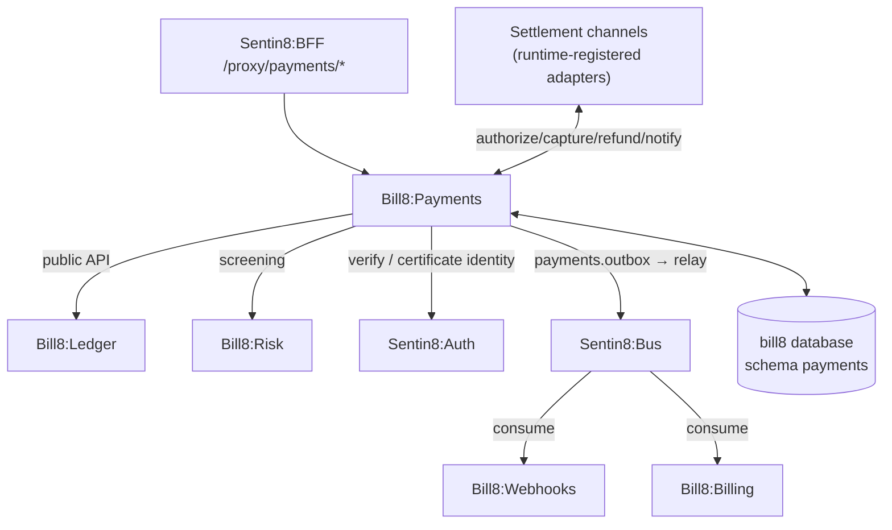

# Bill8:Payments - Core Payments Service

The system of record for payment acceptance: customers, payment methods,
intents, charges, refunds, disputes - routed through selectable
settlement channels.

## 1. Summary

Bill8:Payments owns the charge lifecycle - from a payment intent
through authorization, capture, and settlement to refund and dispute.
It routes every charge through a **selectable settlement channel**
(the platform's finance vertical, external acquirer/payment-platform
adapters, or direct bank rails - runtime-registered, never hardcoded),
records every charge immutably, moves money only through the ledger
service, and emits events that drive webhooks and billing.

## 2. Motivation

Payment acceptance needs provable invariants: a charge can only be
refunded once its funds are captured, a refund can never exceed the
charged amount, and a retried request can never double-move money. The
service centralizes these invariants so downstream services (billing,
checkout) never re-implement them. The rails layer is pluggable by the
same principle: channels are data + adapters, so onboarding a new rail
is a registration, not a core change.

## 3. Architecture & High-Level Design

## 4. Key Traits and Data Structures

- `Charge` - an append-only money capture record with a strict state
  machine (`pending` → `succeeded` / `failed`, then optionally
  `refunded` / `partially_refunded`); carries the channel reference and
  the route decision that produced it.
- `ChannelAdapter` - the settlement-rails contract (`authorize`,
  `capture`, `refund`, `dispute_ingest`, `settlement_report`); any
  channel conforming to it is runtime-registered with a capability
  matrix (methods, regions, recurring, live/test).
- `Refund` - a compensating record referencing a charge; its amount is
  bounded by the charge's remaining refundable amount.
- `Dispute` - a challenge to a charge that can claw back funds and carry
  evidence.

## 5. Rationale, Trade-offs, and Alternatives

- **Append-only charges** over mutable rows: mutation erases history;
  compensating records (refunds/disputes) preserve a replayable trail.
- **Pluggable channels over a single rail**: channel identity is
  registry data + an adapter - onboarding a channel is data, not a core
  change, and routing (cost/method/geo/failover) stays declarative.
- **Money movement delegated to the ledger** over channel-side balance
  writes: a channel never mutates balances; the single double-entry
  authority keeps the books coherent.
- **Rejected**: an in-service balance cache - always stale; the ledger is
  the truth. A hardcoded channel list in core code.

## 6. Internal Implementation & Invariants

- Charges append-only; terminal states never regress.
- A charge is `succeeded` only after channel terminal success AND the
  ledger posting commit - a channel failure writes nothing.
- Routing fails closed; channel notifications signature-verified and
  idempotent.
- Refund amount ≤ charged amount − prior refunds (guarded update).
- Idempotency `(env_id, idempotency_key)` unique per mutation.

## 7. Unresolved Questions / Future Designs

- See `DESIGN.md` §10.

---

**Design attribution:** bill8:payments and its underlying concepts were designed by Hamid Jahanzad <Hamid@Jahanzad.com>.
